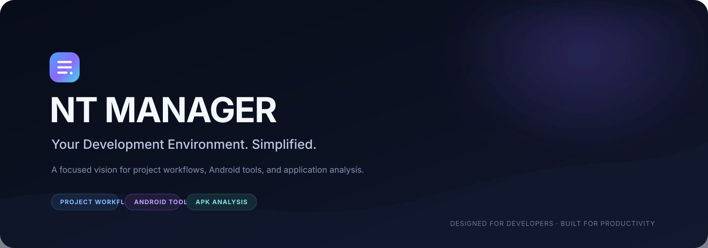

# NT MANAGER

  

  
  
  

<strong>Your Development Environment. Simplified.</strong> One organized workspace for project workflows, Android tooling, signing, interface customization, and application analysis.

> **Project status:** An APK named [`NT.MANAGER.apk`](https://github.com/hakmedevs-svg/NT-MANAGER/releases/tag/untagged-e141f93576a0dfda6ab3) is attached to the GitHub release. GitHub currently marks that release as a **draft**; it has no version tag or publication date yet, so public download availability is not confirmed. This repository contains no application source code or build configuration. The capabilities described below represent the project direction—not features verified as implemented. See [Releases](RELEASES.md) for current details.

## Table of contents

- [About](#about)
- [Product direction](#product-direction)
- [Feature areas](#feature-areas)
- [Dashboard concept](#dashboard-concept)
- [Installation](#installation)
- [Documentation](#documentation)
- [Releases and version history](#releases-and-version-history)
- [Contributing](#contributing)
- [License](#license)
- [Developer and support](#developer-and-support)

## About

NT MANAGER is an early-stage development utility by **Hakmedev**. Its goal is to make common project and Android application workflows easier to navigate through a modern, organized interface—without requiring developers to operate every task manually from a terminal.

An APK asset is attached to the project's GitHub release. The release is currently a draft without a version tag or publication date. The repository itself contains project documentation and branding, but no application source code or build configuration. The application's programming language, framework, supported operating systems, and verified feature set cannot be confirmed from the available source files. Documentation distinguishes intended workflows from functionality verified in the repository; this project makes no claim of universal compatibility or error-free builds.

## Product direction

The product is envisioned as a unified workspace for project setup and management, configurable build workflows, application signing, login-interface customization, and authorized APK inspection. Project-specific tools and resources should be configurable rather than assumed to work across every project.

### Feature areas

The following are **planned product capabilities**. They are not represented as implemented in the source files currently available in this repository.

#### Advanced build system

A guided build center is envisioned for Android Studio projects, Android application workflows, and other supported software projects, including workflows that use VS Code. Potential capabilities include:

- Configurable environments and project-specific build-tool versions.
- Build-configuration management and organized build outputs.
- Build diagnostics and clear error reporting.
- A guided workflow to open **Settings → Build Tools**, select and download a tool version appropriate for a project, configure the environment, and initiate a build.

Actual project compatibility will depend on its framework, toolchain, configuration, and the eventual implementation. This is not a promise of universal compatibility or successful builds in every environment.

#### Application signing

A future signing interface may help developers configure Android application signing, manage keystore references, organize signed outputs, and verify signatures. The intended scope includes appropriate Android signing schemes as supported by the eventual toolchain. Keystore files and passwords are sensitive: a future implementation should handle them securely, and developers should keep secure backups and avoid committing credentials.

#### Login interface injection

The planned customization workflow is intended to let developers import a custom login-screen design, configure its resources, adapt the interface for a supported project, and validate relevant resources and dependencies. Authentication logic is separate: **importing a login interface does not create a secure authentication backend**. Developers must implement and configure authentication, authorization, session handling, and any required server-side protections themselves.

#### APK analysis and decompilation

A future analysis area may support APK and package-information inspection, manifest and resource review, project-structure examination, resource management, and decompiled-source exploration where supported. These workflows are intended for debugging, learning, and authorized analysis only. **Analyze only applications you own or are explicitly authorized to inspect.** Decompilation support and output will depend on the tools and application format involved.

## Dashboard concept

The proposed home screen uses clear navigation, readable typography, consistent spacing, and distinct cards for the following areas. These labels describe the intended information architecture, not existing application screens.

| Icon | Section | Purpose |
|:--:|---|---|
| 📁 | **Project Manager** | Organize projects and review project-specific settings. |
| 🛠️ | **Build Center** | Configure and launch supported project build workflows. |
| 🤖 | **Android Tools** | Find Android-focused project utilities in one place. |
| 🔐 | **Application Signing** | Configure signing workflows and review signature status. |
| 🎨 | **Login UI Injection** | Customize login-screen resources for supported projects. |
| 🔍 | **APK Analyzer** | Inspect application packages and their metadata. |
| 🧩 | **Decompilation Tools** | Explore decompiled content where supported and authorized. |
| ⚙️ | **Build Tools Manager** | Select and manage project-specific build tools. |
| 🛠️ | **Settings** | Configure the workspace and available integrations. |
| ℹ️ | **About NT MANAGER** | View project, version, and support information. |

**Suggested welcome copy**

> Welcome to NT MANAGER  
> **Your Development Environment. Simplified.**  
> Build, manage, analyze, and customize your projects using one powerful and organized workspace.

## Installation

An APK named [`NT.MANAGER.apk`](https://github.com/hakmedevs-svg/NT-MANAGER/releases/tag/untagged-e141f93576a0dfda6ab3) is attached to the GitHub release. The release is currently marked as a draft, so a public download is not confirmed. No version tag, publication date, minimum Android version, or device requirements are available in its metadata. See [installation guidance](docs/INSTALLATION.md) and review the release page before installing. Do not use third-party downloads presented as NT MANAGER releases.

## Documentation

- [Feature overview](docs/FEATURES.md) — proposed capabilities and important limitations.
- [Installation](docs/INSTALLATION.md) — APK release status and current installation information.
- [Build guide](docs/BUILD_GUIDE.md) — APK availability and source build status.
- [Release history](RELEASES.md) — current APK asset and release status.
- [Changelog](CHANGELOG.md) — repository-level documentation changes.
- [Contributing](CONTRIBUTING.md) — how to contribute as the project develops.

## Releases and version history

An APK is attached to the NT MANAGER GitHub release, which GitHub currently marks as a draft. The version number, publication date, compatibility information, and detailed change notes are not provided in the release metadata, so they are not guessed here. Review [RELEASES.md](RELEASES.md) and the [GitHub release page](https://github.com/hakmedevs-svg/NT-MANAGER/releases/tag/untagged-e141f93576a0dfda6ab3) for its current status and asset.

## Contributing

Contributions, suggestions, and issue reports are welcome. Read [CONTRIBUTING.md](CONTRIBUTING.md) before opening a change. Please distinguish verified behavior from proposals, avoid including secrets or proprietary application data, and provide steps to reproduce any reported issue.

## License

NT MANAGER is distributed under the [MIT License](LICENSE). See the license file for its terms.

## Developer and support

**Developed by Hakmedev**

For community updates and support, visit [Telegram](https://t.me/hhyr10) or contact **[@hhyr10](https://t.me/hhyr10)**.

---

<strong>Designed for developers. Built for productivity.</strong> <strong>NT MANAGER — One Workspace. Endless Possibilities.</strong>

